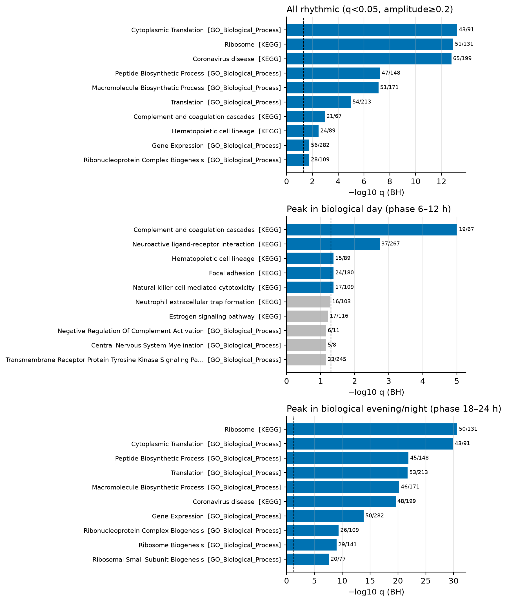
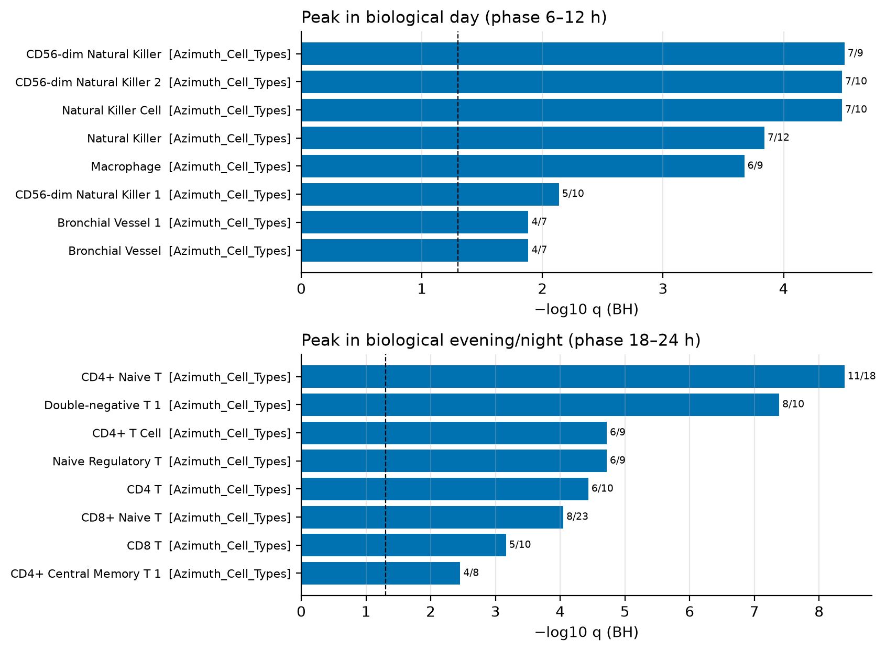
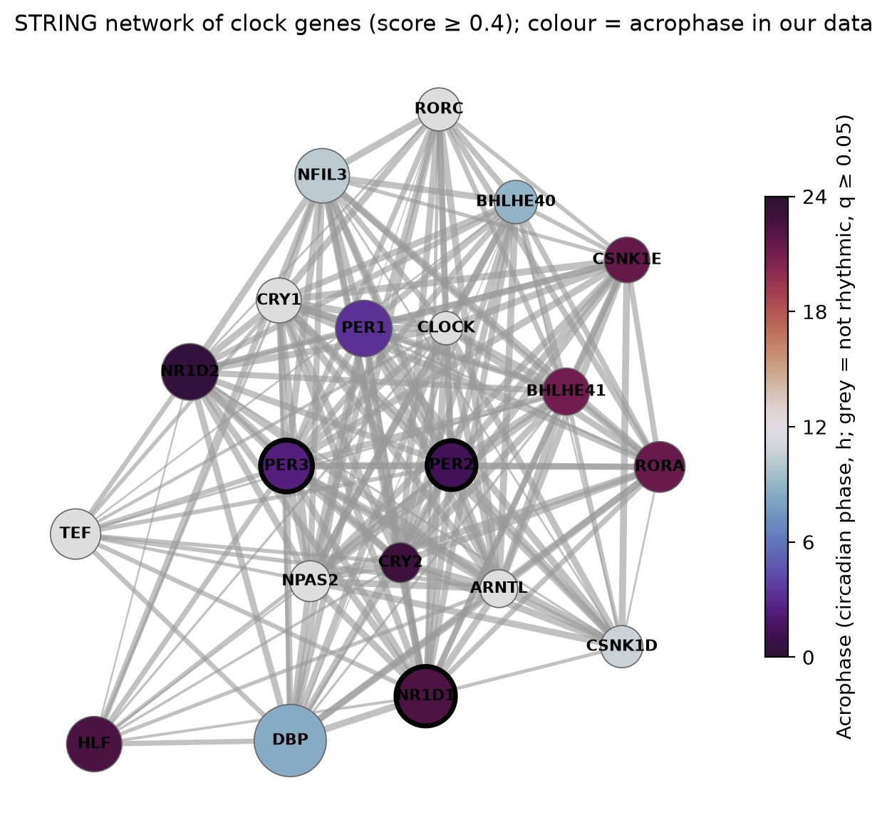
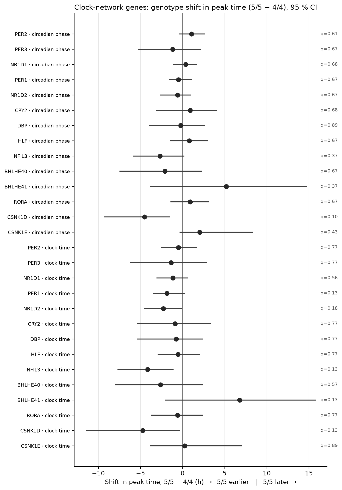

# Biological interpretation (Stage 6): what the results mean

This document explains Stage 6 of the project in plain language: what we did, what we found, what it means biologically, and how to read each figure. The code and full output are in [`notebooks/stages/06_interpretation.ipynb`](../notebooks/stages/06_interpretation.ipynb). The functions are in [`src/per3clock/interpret.py`](../src/per3clock/interpret.py). The tables are in [`results/tables/`](../results/tables/).

---

## The short version

- **The body clock is clearly running in blood.** The main clock genes rise and fall once a day, in the order the clock's wiring predicts.
- **Most of the daily rhythm in blood comes from immune cells moving in and out of the bloodstream.** T cells are plentiful at night. NK cells and monocytes are plentiful during the day. This is known physiology, and our data reproduce it.
- **PER3 is a central part of the clock machinery**, directly linked to every other clock gene we looked at.
- **We could not show that PER3 genotype changes when the clock genes peak.** People with the "early bird" genotype (5/5) tend to have all their clock genes peak about an hour earlier by the clock. This is about the same as how much earlier they wake up and how much earlier their melatonin rhythm runs, and the difference is not statistically significant. Measured against each person's own internal clock, the difference disappears.
- **The result is inconclusive, not negative.** With only 11–13 people per group, we cannot rule out a real shift of 1–3 hours.

---

## 1. Background in plain terms

**The body clock.** Almost every cell in the body has a molecular clock that runs on a roughly 24-hour cycle. It is made of *clock genes* whose activity rises and falls through the day. They switch each other on and off in loops, like gears in a watch. A master clock in the brain keeps them all in time with day and night.

**The clock genes in this project.**
- **PER2, PER3 and NR1D1** are our three main genes.
- **PER1, CRY1, CRY2, CLOCK, ARNTL** and others are their partners in the same loops.

**PER3 genotype.** People carry either a short (4) or a long (5) version of a repeated stretch in the PER3 gene. Earlier studies linked **5/5** (two long copies) to being a morning person ("early bird") and **4/4** to being an evening person ("night owl").

**Two ways of measuring time** are used throughout:
- **Clock time:** the time on the wall clock (e.g. 05:42).
- **Circadian phase:** time measured against each person's own internal clock, using their melatonin rhythm. Melatonin is the "darkness hormone" and is a standard marker of the master clock. **Phase 0 is the middle of the person's biological night (the melatonin midpoint).** In this study that fell, on average, at about **04:00** by the clock.
  - "**Biological day**" (phase 6–12 h) is therefore roughly **10:00–16:00**.
  - "**Biological evening/night**" (phase 18–24 h) is roughly **22:00–04:00**.

Why the difference matters: if 5/5 people peak earlier on the **clock** but not on their **internal** clock, then their whole clock, sleep schedule included, is set earlier. That is different from PER3 genotype changing how the clock genes behave.

**What Stage 5 found.** The clock genes are clearly rhythmic. However, the difference between genotypes in when PER2, PER3 and NR1D1 peak was not statistically significant, and every 95 % confidence interval included zero.

**What Stage 6 adds.** Stage 6 asks what the results *mean* biologically. It uses three approaches:
1. **Enrichment analysis:** what jobs do the rhythmic genes do?
2. **Network analysis:** how is PER3 connected to the rest of the clock, and does the *whole* clock shift with genotype?
3. **Literature comparison:** do our numbers agree with published research?

---

## 2. What do the rhythmic genes do? (enrichment analysis)

### The method in plain terms
Stage 5 found thousands of genes whose activity follows a daily rhythm. A list of 2,000 gene names means little by itself. **Enrichment analysis** checks the list against catalogues that group genes by their job. The catalogues used were:
- **GO Biological Process**, which groups genes by biological process (e.g. "translation", "immune response").
- **KEGG**, which groups genes by pathway (e.g. "Ribosome", "Circadian rhythm").
- **Azimuth**, which groups genes by the blood cell type they mark.

The test asks a simple question: *does our list contain more genes from a given group than we'd expect by chance?* As an analogy, if 10 % of all books in a library are cookbooks but 40 % of the books someone borrowed are cookbooks, that person probably likes cooking.

To keep the test fair:
- We compared against the **17,528 genes actually detectable on the microarray**, not all human genes.
- We corrected for testing thousands of groups at once. That correction produces the **q-value**: q < 0.05 means "unlikely to be a fluke even after testing many groups".

### Which genes we used
- Genes with a clear daily rhythm (q < 0.05) **and** a reasonably large rise and fall (amplitude ≥ 0.2 on the log₂ scale, i.e. a peak-to-trough change of about 30 % or more): **2,007 genes**. We set this cut-off *before* looking at any results.
- Almost all of them peak in one of two windows:

| Peak window (circadian phase) | Approx. clock time | Number of genes |
|---|---|---|
| Biological day (6–12 h) | ~10:00–16:00 | **1,149** |
| Biological evening/night (18–24 h) | ~22:00–04:00 | **780** |
| Anything else | | 78 |

So blood has **two main daily programmes**, one for the day and one for the night. We tested each separately.

### Figure 1 – Top biological processes

**How to read it**
- Three panels: all rhythmic genes (top), genes peaking in the biological day (middle), and genes peaking in the biological evening/night (bottom).
- Each bar is one biological process or pathway. The label in square brackets says which catalogue it came from (GO or KEGG).
- **Bar length** shows how strong the evidence is, on a −log₁₀ q scale. Longer means stronger: a value of 2 means q = 0.01, and 10 means q = 0.0000000001.
- The **dashed vertical line** is the significance threshold (q = 0.05). **Blue bars** cross it (significant). **Grey bars** do not.
- The **numbers at the end** of each bar (e.g. "50/131") mean that 50 of the 131 genes in that pathway are in our list.
- The x-axes differ between panels. Compare bar lengths within a panel, not across panels.

**What it shows**
- **Night-peaking genes (bottom panel):** overwhelmingly genes for **making proteins**, i.e. ribosomes and translation. For example, 50 of 131 ribosome genes are in the list, about 8.6 times more than expected (q = 2 × 10⁻³¹). The "Coronavirus disease" pathway also appears, but only because that KEGG pathway happens to include ribosomal proteins: 45 of its 48 genes in our list are ribosomal. It does **not** mean anything about infection.
- **Day-peaking genes (middle panel):** **innate immune defence and blood clotting.** The top terms are complement and coagulation (19/67 genes, q = 1 × 10⁻⁵), natural killer (NK) cell cytotoxicity (killer-cell receptor genes, granzyme B, perforin) and haematopoietic (blood-cell) lineage.
- **All rhythmic genes (top panel):** a mix of the two, dominated by the ribosome/translation signal.

### Figure 2 – Which blood cell types?

**How to read it.** The bars work exactly as in Figure 1, but each bar is now a **blood cell type** instead of a process. A cell type scores highly when many of its *marker genes* (genes that are especially active in that cell type) are in our list. Numbered entries such as "Natural Killer 1" and "Natural Killer 2" are sub-groups of the same cell type.

**What it shows**
- **Night-peaking genes** are markers of **T cells**, especially *naive* CD4⁺ T cells (11 of 18 markers, about 14 times more than expected, q = 4 × 10⁻⁹), plus naive CD8⁺ and regulatory T cells. Naive T cells contain a lot of ribosome RNA, which explains why Figure 1 shows a ribosome signal at night.
- **Day-peaking genes** are markers of **NK cells** (CD56-dim NK, 7 of 9 markers, q = 3 × 10⁻⁵) and **macrophages/monocytes**.

### What this means biologically
The blood is not a fixed mixture: **the types of white cells in circulation change through the day.**
- At **night**, naive T cells fill the bloodstream.
- In the **morning**, the rise in the stress hormone **cortisol** makes T cells leave the blood for the bone marrow and lymphoid tissues.
- During the **day**, adrenaline-type hormones bring **NK cells and other "first-responder" immune cells** into the blood.

Our gene lists reproduce this pattern closely (see Section 5 for the published studies).

**The clock genes themselves do not stand out in this analysis.** The KEGG "Circadian rhythm" pathway is *not* enriched: only 2 of its 28 genes are in the main list, q ≈ 1. This does **not** mean the clock is absent. The clock genes are individually rhythmic (Stage 5). But there are only about 30 of them and their rises and falls are small, so they are swamped by the much larger daily changes in cell composition.

The same picture appears with looser cut-offs (amplitude ≥ 0.1, or no amplitude cut-off); see `results/tables/enrichment_sensitivity.csv`.

### Link to the research question
We measured PER2, PER3 and NR1D1 in **whole blood**, which is a mixture of cell types that changes over the day. The "peak time" of a clock gene in blood therefore reflects two things: (a) the clocks *inside* the cells, and (b) *which* cells are present at each hour. A PER3 effect could act through either. Conversely, a small genuine shift inside cells could be blurred by the large cell-traffic rhythm. This is a real limitation of using whole blood to answer our question.

---

## 3. How is PER3 wired into the clock? (network analysis)

### The method in plain terms
**STRING** is a public database that records which proteins are known or predicted to work together. Its evidence comes from laboratory experiments, curated pathway databases, co-mention in scientific papers ("text mining") and other sources. Each link gets a **confidence score from 0 to 1**. We kept links scoring at least 0.4 (STRING's "medium confidence").

We looked up 20 clock genes:
- the 8 clock genes of the project;
- 12 well-known partners: CRY2, NPAS2, DBP, TEF, HLF, NFIL3, BHLHE40/41, RORA, RORC, CSNK1D/E.

We drew the result as a **network**: genes are dots and links are lines. We then measured how *central* each gene is (how many links it has, and whether it acts as a bridge between other genes).

### Figure 3 – The clock-gene network

**How to read it**
- **Each circle is a gene. Each line is a known interaction** from STRING.
- **Thicker lines** mean higher confidence.
- **Circle colour = when that gene peaks in *our* data**, as circadian phase. Use the colour bar on the right:
  - very dark (near 0 or 24) is around the middle of the biological night;
  - purple (~0–6 h) is the late night and early morning;
  - light blue (~6–12 h) is the biological day;
  - red/maroon (~18–24 h) is the biological evening.
  - **Grey circles** are genes with no significant daily rhythm in our blood data (CLOCK, ARNTL, CRY1, NPAS2, RORC, TEF).
- **Circle size = how large the daily rise and fall is.** DBP has the largest.
- **Thick black outline** marks our three main genes: PER2, PER3 and NR1D1.
- The *positions* of the circles have no meaning in themselves. The drawing algorithm pulls strongly linked genes together.

**What it shows**
- **The clock is one tight, densely connected unit.** The 20 genes share 171 of the 190 possible links (90 %), and 115 of those links have very high confidence (≥ 0.9).
- **PER3 is linked to all 19 other genes**, which is the maximum possible. It ties with PER2, NR1D1, CRY1, CRY2, CLOCK, ARNTL and NPAS2.
  - Because nearly everything is connected to everything, the "centrality" scores barely differ between genes (`results/tables/network_centrality.csv`). The network cannot single out one gene as "the most important".
  - It does show that **PER3 is not a side player**: it sits in the core of the clock.
- **The three main genes:**
  - **PER2–PER3** is supported by strong laboratory evidence (score 0.998). PER proteins work together as the "brake" of the clock loop.
  - **NR1D1–PER2** and **NR1D1–PER3** are supported mainly by the scientific literature (text mining). They are part of the same feedback loops rather than proteins that physically bind each other.
- **The peak order in our data matches the clock's design.** Relative to the middle of the biological night:

| Gene | Peak (h relative to melatonin midpoint) |
|---|---|
| NR1D1 | −1.6 |
| NR1D2 | +0.3 |
| PER2 | +1.3 |
| PER3 | +2.4 |
| PER1 | +3.3 |
| DBP, BHLHE40, NFIL3 | +8.5 to +10.7 (biological day) |

  The clock genes rise one after another in an orderly cascade. This is good evidence that we are seeing a real, coherent clock in blood and not noise.

### Does the whole clock shift with PER3 genotype?
Stage 5 tested PER2, PER3 and NR1D1 one at a time. The network allows a stronger test. **If PER3 genotype moved the clock, all the rhythmic clock genes should move together, in the same direction.** We therefore repeated the genotype comparison for all **14** clock-network genes with a significant rhythm. We then asked whether, taken together, they show a consistent shift.

One important detail: within one person, the clock genes are strongly linked to each other. If one runs early, the others tend to as well. So "12 out of 14 genes are earlier" is *not* 12 independent pieces of evidence. Our test handles this by shuffling the genotype labels **between people** (a permutation test), keeping each person's genes together.

### Figure 4 – Genotype difference for every clock-network gene

**How to read it**
- Each row is one gene, measured either as **circadian phase** (top half, relative to the internal clock) or as **clock time** (bottom half, wall-clock time).
- **The dot** is the estimated difference in peak time between genotypes, *5/5 minus 4/4*, in hours.
  - **Left of the vertical zero line** means 5/5 peaks **earlier**.
  - **Right** means 5/5 peaks **later**.
- **The horizontal line** through each dot is the **95 % confidence interval**: the range of shifts compatible with the data. If it crosses zero, the data are compatible with no difference.
- **The q-value on the right** is the p-value corrected for testing 14 genes. Values below 0.05 would count as significant.
- Wide lines mean an uncertain estimate. These are usually genes whose rhythm is weak or inconsistent between people (e.g. BHLHE41).

**What it shows**
- **No gene shows a significant genotype difference** on either time scale. Every q-value is 0.10 or higher.
- A few genes have intervals that just miss zero: CSNK1D on both scales, and NFIL3 and NR1D2 on clock time. After correcting for testing 14 genes, none of these is significant. They are what one would expect by chance when testing many genes.
- **On clock time (bottom half), most dots sit left of zero**: 12 of 14 genes peak earlier in 5/5.
- **On circadian phase (top half), the dots are scattered evenly around zero**: 7 earlier, 7 later.

The combined, whole-network test (`results/tables/network_shift_test.csv`):

| Time scale | Genes earlier in 5/5 | Average shift (95 % CI) | p-value |
|---|---|---|---|
| Clock time | 12 of 14 | **−1.0 h** (−3.5 to +0.6) | 0.28 |
| Circadian phase (internal clock) | 7 of 14 | **−0.04 h** (−1.8 to +1.1) | 0.95 |

### What this means biologically
- **By the clock**, the whole clock network of 5/5 carriers tends to run about **1 hour earlier**.
  - That is almost exactly how much earlier the 5/5 group **woke up (1.2 h)** and how much earlier their **melatonin rhythm ran (1.3 h)** (Stage 4).
  - The difference is not statistically significant. The interval runs from 3.5 h earlier to 0.6 h later.
- **Measured against each person's own internal clock**, the clock genes of the two genotypes line up almost perfectly (average difference 0.04 h, about 2 minutes).
- **Interpretation:** if PER3 genotype has an effect, it looks like the **whole sleep–clock system is set earlier** in 5/5 carriers: their melatonin, their waking time and their clock genes together. The clock genes are not peaking at a different time *relative to* the internal clock. In other words, 5/5 carriers look like *early birds* whose clock is set earlier, not people whose clock genes are mistimed.

---

## 4. Do our results agree with published research?

Every study below was checked on PubMed. The published values are quoted from the papers' abstracts. Full table: `results/tables/literature_comparison.csv`.

| Topic | Published finding | Our finding | Agree? |
|---|---|---|---|
| Number of rhythmic genes in this dataset | 1,855 after a week of sufficient sleep (Möller-Levet et al. 2013) | 2,007 with our amplitude cut-off (9,577 without it) | **Yes**, with the cut-off. Our method picks up very small rhythms, so without a cut-off it finds many more. |
| PER3 peak time | 06:05 in white blood cells (Archer et al. 2008) | 05:42 | **Yes**, within half an hour |
| PER2 peak time | 08:06 (Archer et al. 2008) | 05:13 | **No**, ours is ~3 h earlier (possible reasons below) |
| PER3 relative to melatonin | ~1.8 h after the melatonin peak (Archer et al. 2008) | ~1.6 h after the melatonin midpoint | **Yes** |
| PER3 genotype and clock timing | Genotype did **not** change the timing of melatonin, cortisol or PER3 activity in 24 people (Viola et al. 2007) | No significant genotype shift for any clock gene | **Yes**, both find no effect, and both studies are small |
| PER3 5/5 and sleep timing | 5/5 carriers wake and go to bed earlier and prefer mornings (Lázár et al. 2012, 675 people; Archer et al. 2003) | Our 5/5 group woke 1.2 h earlier and its melatonin ran 1.3 h earlier | **Yes**, same direction |
| T cells at night | Naive T cells are highest at night and fall in the morning, driven by cortisol (Dimitrov et al. 2009; Besedovsky et al. 2014). They have the most robust daily rhythm of blood cell types (Ackermann et al. 2012) | Night-peaking genes are T-cell markers | **Yes** |
| Killer cells during the day | Cytotoxic effector T cells peak during the day, driven by adrenaline (Dimitrov et al. 2009) | Day-peaking genes are NK-cell (cytotoxic) markers | **Consistent** |

**Why PER2 might differ.** There are several plausible reasons, and we cannot tell which applies:
- Archer et al. measured purified white blood cells; we used whole blood.
- They used a "constant routine" protocol; our participants stayed awake for ~40 hours after a week of extended sleep.
- Our samples were taken only every 3 hours.
- PER2's daily rise and fall is small, which makes its peak harder to pinpoint.

---

## 5. What it all means for the research question

**Research question:** *Does PER3 genotype (4/4 vs 5/5) shift the time of day at which PER2, PER3 and NR1D1 reach peak expression in human blood?*

1. **The clock is there and behaves as expected.** PER2, PER3 and NR1D1 (and their partners) rise and fall daily, in the textbook order, at times that match published data.
2. **PER3 is a core part of that clock.** Biologically, it is well placed to influence clock timing.
3. **We do not detect a genotype effect on clock-gene timing.**
   - On clock time, 5/5 carriers' clock genes tend to peak about 1 hour earlier, but this is not significant.
   - Relative to their own melatonin rhythm, there is no difference at all.
4. **The most consistent explanation:** 5/5 carriers live on a slightly earlier schedule, waking earlier with an earlier melatonin rhythm. Their clock genes move along with that schedule. This fits the known link between PER3 5/5 and morning preference. It also fits the earlier finding that PER3 genotype does not change the timing of PER3 activity relative to melatonin (Viola et al. 2007).

---

## 6. What the data do **not** show (limitations)

- **They do not prove that PER3 genotype has no effect.** With 11–13 people per group, the study can only detect large differences. On clock time, a real shift of 1–3 hours is still compatible with the data.
- **Enrichment and STRING describe associations and existing knowledge, not mechanisms.** A gene being "enriched" or "linked" does not show what causes what.
- **Whole blood mixes two signals:** the clocks inside the cells, and the daily changes in which cells are present. Without cell counts or sorted cell populations, we cannot separate them.
- **The study design links time awake and time of day.** Participants stayed awake for ~40 hours, so effects of increasing sleepiness and of time of day partly overlap (see Stage 5).
- **Only 3-hour sampling.** Peak times between samples are estimated by fitting a curve, which limits precision.

---

## 7. Glossary

| Term | Meaning |
|---|---|
| **Clock genes** | Genes whose products form the molecular 24-hour clock (e.g. PER, CRY, NR1D1, CLOCK, ARNTL/BMAL1). |
| **Peak time / acrophase** | The time of day at which a gene's activity is highest, estimated by fitting a 24-hour wave (cosinor). |
| **Amplitude** | How far a gene's activity rises above its daily average (half the peak-to-trough difference), on the log₂ scale. |
| **Circadian phase** | Time measured on the person's internal clock. 0 = the middle of their melatonin night (about 04:00 by the clock here). |
| **Melatonin** | A hormone released at night. Its timing is the standard marker of the brain's master clock. |
| **Enrichment (over-representation) analysis** | A test of whether a gene list contains more genes from a known group than expected by chance. |
| **Background** | The set of genes the list is compared against. Here, the 17,528 genes detectable on the microarray. |
| **q-value** | A p-value corrected for running many tests at once (Benjamini–Hochberg). q < 0.05 is our significance threshold. |
| **Fold enrichment** | How many times more genes from a group are in our list than expected by chance. |
| **STRING** | A database of known and predicted protein–protein interactions, with a confidence score (0–1) for each link. |
| **Degree / centrality** | Network measures of how many links a gene has and how much it connects other genes. |
| **95 % confidence interval (CI)** | The range of values compatible with the data. If it includes 0, "no difference" cannot be ruled out. |
| **Permutation test** | A test that reshuffles the genotype labels many times to see how often a difference as large as ours arises by chance. |
| **Naive T cells** | T cells that have not yet met their target. They circulate in large numbers at night. |
| **NK (natural killer) cells** | Innate immune cells that kill infected or abnormal cells. They are more abundant in blood during the day. |

---

## 8. Where everything is

| Output | File |
|---|---|
| Enrichment: all rhythmic genes | `results/tables/enrichment_rhythmic.csv` |
| Enrichment: day vs night genes | `results/tables/enrichment_rhythmic_by_phase.csv` |
| Enrichment: blood cell types | `results/tables/enrichment_cell_types.csv` |
| Enrichment: sensitivity to the cut-off | `results/tables/enrichment_sensitivity.csv` |
| STRING links | `results/tables/string_edges.csv` |
| Network centrality and peak times | `results/tables/network_centrality.csv` |
| Genotype shift per network gene | `results/tables/network_genotype_shifts.csv` |
| Whole-network genotype test | `results/tables/network_shift_test.csv` |
| Literature comparison | `results/tables/literature_comparison.csv` |
| Figures 1–4 | `results/figures/enrichment_top_terms.png`, `enrichment_cell_types.png`, `string_network.png`, `network_genotype_shifts.png` |

To reproduce everything, run `notebooks/stages/06_interpretation.ipynb` top to bottom. Gene-set libraries and STRING responses are downloaded once and cached in `data/external/`.

---

## References
All checked on PubMed (PMID and DOI) on 2026-11-15; BibTeX entries are in [`references.bib`](references.bib).

- Ackermann K, Revell VL, Lao O, et al. (2012) Diurnal rhythms in blood cell populations and the effect of acute sleep deprivation in healthy young men. *Sleep* 35(7):933–940. doi:10.5665/sleep.1954 (PMID 22754039)
- Archer SN, Robilliard DL, Skene DJ, et al. (2003) A length polymorphism in the circadian clock gene Per3 is linked to delayed sleep phase syndrome and extreme diurnal preference. *Sleep* 26(4):413–415. doi:10.1093/sleep/26.4.413 (PMID 12841365)
- Archer SN, Viola AU, Kyriakopoulou V, von Schantz M, Dijk DJ (2008) Inter-individual differences in habitual sleep timing and entrained phase of endogenous circadian rhythms of BMAL1, PER2 and PER3 mRNA in human leukocytes. *Sleep* 31(5):608–617. doi:10.1093/sleep/31.5.608 (PMID 18517031)
- Besedovsky L, Born J, Lange T (2014) Endogenous glucocorticoid receptor signaling drives rhythmic changes in human T-cell subset numbers and the expression of the chemokine receptor CXCR4. *FASEB J* 28(1):67–75. doi:10.1096/fj.13-237958 (PMID 24051033)
- Dimitrov S, Benedict C, Heutling D, et al. (2009) Cortisol and epinephrine control opposing circadian rhythms in T cell subsets. *Blood* 113(21):5134–5143. doi:10.1182/blood-2008-11-190769 (PMID 19293427)
- Fang Z, Liu X, Peltz G (2023) GSEApy: a comprehensive package for performing gene set enrichment analysis in Python. *Bioinformatics* 39(1):btac757. doi:10.1093/bioinformatics/btac757 (PMID 36426870)
- Hao Y, Hao S, Andersen-Nissen E, et al. (2021) Integrated analysis of multimodal single-cell data. *Cell* 184(13):3573–3587. doi:10.1016/j.cell.2021.04.048 (PMID 34062119)
- Lázár AS, Slak A, Lo JC, et al. (2012) Sleep, diurnal preference, health, and psychological well-being: a prospective single-allelic-variation study. *Chronobiol Int* 29(2):131–146. doi:10.3109/07420528.2011.641193 (PMID 22324552)
- Möller-Levet CS, Archer SN, Bucca G, et al. (2013) Effects of insufficient sleep on circadian rhythmicity and expression amplitude of the human blood transcriptome. *PNAS* 110(12):E1132–E1141. doi:10.1073/pnas.1217154110 (PMID 23440187)
- Szklarczyk D, Kirsch R, Koutrouli M, et al. (2023) The STRING database in 2023. *Nucleic Acids Res* 51(D1):D638–D646. doi:10.1093/nar/gkac1000 (PMID 36370105)
- Takahashi JS (2017) Transcriptional architecture of the mammalian circadian clock. *Nat Rev Genet* 18(3):164–179. doi:10.1038/nrg.2016.150 (PMID 27990019)
- Viola AU, Archer SN, James LM, et al. (2007) PER3 polymorphism predicts sleep structure and waking performance. *Curr Biol* 17(7):613–618. doi:10.1016/j.cub.2007.01.073 (PMID 17346965)
- Xie Z, Bailey A, Kuleshov MV, et al. (2021) Gene set knowledge discovery with Enrichr. *Curr Protoc* 1(3):e90. doi:10.1002/cpz1.90 (PMID 33780170)
